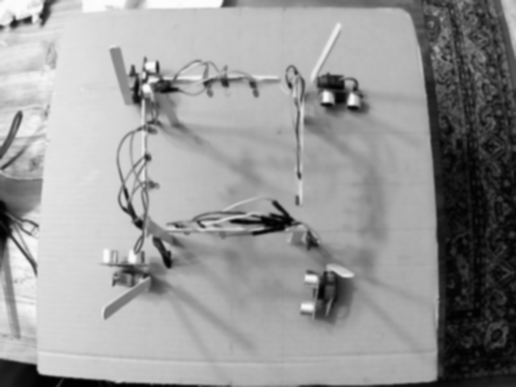

# Smart Intersection - Emergency Vehicle Priority

### Prezentare
Camera detectează lumina albastră în mișcare (ambulanță) într-una din cele 4 direcții și trimite comanda pe serială către Arduino pentru a prioritiza acea direcție.

### Diagrama Fluxului
`Cameră` → `Python/OpenCV` → `Serial` → `Arduino` → `Semafoare, Bariere, Senzori`

### Poze și Demo

### Protocol Serial
- `'1' - '4'`: Direcția ambulanței (1=NORD, 2=SUD, 3=EST, 4=VEST)
- `'0'`: Anulare/Resetare mod prioritate

### Configurație Hardware
Folosește o placă **Arduino Mega 2560**.

| Componentă | Pini |
| :--- | :--- |
| Semafoare (V, G, R) | NORD: 50,49,48; SUD: 37,31,39; EST: 47,41,40; VEST: 35,34,36 |
| Senzori Ultra (T, E) | NORD: 23,22; SUD: 25,24; EST: 44,45; VEST: 28,26 |
| Servomotoare | NORD: 3; SUD: 5; EST: 9; VEST: 6 |

### Cum rulezi
1. Instalează dependențele: `pip install -r requirements.txt`
2. Încarcă schița din `firmware/smart_intersection/` pe Arduino.
3. Rulează scriptul Python:
   - Cu hardware: `python vision/main.py --port COM3`
   - Mod DEMO (fără Arduino): `python vision/main.py --port None`
   - Testare pe video: `python vision/main.py --video path/to/video.mp4`

### Limitări și Îmbunătățiri Viitoare
- **Limitare**: Fundalul se calibrează o singură dată la pornire; schimbările de lumină pot afecta detecția.
- **Limitare**: Orice obiect albastru în mișcare poate declanșa sistemul.
- **Îmbunătățire**: Utilizarea `cv2.createBackgroundSubtractorMOG2` pentru adaptabilitate la lumină.
- **Îmbunătățire**: Implementarea unui detector bazat pe Deep Learning (ex. YOLO) pentru recunoașterea vehiculelor.
